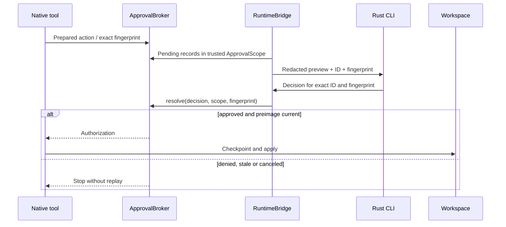

ProtoAgent's safety model is built around ProtoLink actions and policies, not
terminal string parsing.

## Approval-Gated Writes

Coder registers native `filesystem_tools()` with explicit project roots and
checkpoint storage. `filesystem.write` and `filesystem.restore` require approval.
The native tool prepares a `RunAction` with an exact diff and preimage before
`ApprovalBroker` waits for a decision.

## Project approval modes

Use **`/approvals`** to choose a mode in the TUI, or set it directly:

| Mode | TUI | Behavior |
| --- | --- | --- |
| Ask (default) | `/approvals ask` | Review each file edit and command. |
| Edits | `/approvals edits` | Auto-accept file edits; ask before commands, including tests. |
| Auto | `/approvals auto` | Auto-accept file edits and commands. Commands have normal host permissions. |

Shell equivalents are `proto-cli approvals ask`, `proto-cli approvals edits`
and `proto-cli approvals auto`. `/approvals status` (shell: `proto-cli approvals`)
shows the current mode. Preferences are saved for the canonical project path and
apply to subsequent runs. Other projects start in Ask. The TUI shows the current
mode in its status area and configuration panel.

These preferences resolve exact requests through ProtoLink's native broker;
they do not bypass capability policies, planned file scope, revision guards,
budgets or recovery storage. Each automatic decision remains in the native trace
with `decided_by=protoagent-auto`. MCP connections/calls and file restoration
always ask. Auto-accept is an approval preference, separate from verification:
it does not disable tests or turn a failed check into a pass.

## End-of-run edit review

Write runs end with a deterministic list of files, applied edit count and
displayed added/removed line counts alongside the verification result. **`/diff`**
opens the combined applied diff; shell runs print it. Multiple edits to one file
are combined from this run's first native preimage to its final applied snapshot.
Existing uncommitted work is preserved as the starting point, and denied or
unexecuted proposals are excluded. Partial edits remain reviewable after failure,
cancellation or a manual verification handoff.

The CLI and TUI render the edit summary as a compact card: a cyan heading,
bold file names, green additions, red removals and muted status/diff hints.
Colors come from runtime metadata in the frontend; saved answers remain plain
text. File names are displayed literally, including Markdown characters.

If the model ends before executing an edit, the final answer says no changes
were applied instead of displaying its promise or action-shaped text as a result.
A required check with no execution receipt is **not run**, not a failed test.
Missing Python runners or packages are explained as environment/setup problems;
the actual failed command and its exit status remain in the native trace.

Verification normally occupies one line. For example:
`Verification: unavailable (missing pytest). Details: /trace.` A missing Python
runner or external module in a completed final check ends the run with applied
edits **unverified**, without installation questions, automatic setup or code
repairs. Existing project modules remain code/import-path failures; genuine test
failures retain bounded repairs. Canceled, denied, stale or uncertain evidence
cannot be downgraded to this unavailable state. No skipped check is marked passed.
Full commands, output and exit codes remain in `/trace` and the native report.

Before write approval, Python proposals are parsed without executing them. Newly
introduced syntax errors (including double-escaped newlines written as literal
backslash-n code) get no-change correction feedback rather than being applied.
This covers create, replace and exact edits. Already malformed sources can be
repaired incrementally. Passing this guard does not establish correct imports,
names, routes or behavior; Verifier still runs the selected checks.

`/diff proposed` separately displays approval previews, which may include changes
that were never applied; `/diff raw` prints the applied diff in the transcript.
The review marks uncertain effects and files changed since the recorded edit.
If outside changes interrupt a snapshot chain, it shows individual applied steps
instead of attributing those outside changes to the agent. Binary or oversized
files get a summary without a text diff. Review is bounded to 64 files, 1 MiB per
text file and 120,000 diff characters. Native checkpoints retain the complete
recovery records. Effects of process commands or MCP tools outside native file
tools are not included in this diff; inspect their receipts and the workspace.



## Command approval and recovery

Verifier's native `execute_command` requires `process.execute` approval, resolved
automatically only in Auto mode. Its
JSON preview contains argv, absolute cwd, explicit env, timeout, output cap and
host execution boundary. **V opens details; it does not approve or execute.**
Press **Y** to approve and run the exact command, or **N/Esc** to deny from the
approval screen. Inside details or a diff, Y/N decides and Enter/Esc returns
without a decision. The screen distinguishes baseline checks, final verification,
other commands and file changes. A command preview has no proposed file diff;
Coder's file changes receive separate diff approvals. Native cancellation,
timeout and run-budget expiry close the modal and its review automatically.
Late decisions for an ended or replaced presentation are not sent.
Commands run with host access,
without sandbox isolation; no environment is inherited implicitly.

`/undo [id]` selects an applied native change and asks for a fresh restoration
approval without a model. Native revision conflicts preserve newer edits.
Uncertain effects require inspection. See [Verify & Recover](verification-and-recovery.md).

## User feedback

Architect uses ProtoLink's native `ask_user` tool to clarify missing requirements
and continue the current task. Both the TUI and interactive `proto-cli run`
accept free text or optional suggestions. Tab cycles suggestions; Enter sends a
nonblank answer; Esc skips; Ctrl-C cancels the run. The TUI also scrolls long
questions with PageUp/PageDown. No suggested answer is chosen by default.

Native `user_input.*` events retain the question and outcome. Waiting is bounded
by 300 seconds and the remaining runtime budget; responses are limited to 4096
characters and correlated with the exact run/task/action/request. Expired prompts
close automatically. With no interactive frontend (including redirected shell
stdin/stdout), the question declines without reading stdin or inventing consent.
An answer never approves a write, command or MCP call. Live feedback is separate
from checkpointed restart/resume, which is not enabled for the coding Graph.

After edits, you can type **"don't run it, I'll do it"** in a verification
question, even when it is not a suggested answer. ProtoAgent stops immediately
and reports applied files with **verification deferred to you**. The native
failed check remains in `/trace`; the change is not marked verified or satisfied.
Skipping the question does not make that choice. Waiting for your answer counts
toward the run's default ten-minute runtime budget.
If that budget expires during a question, the final report says it reached the
run time limit while waiting for your answer. Earlier partial edits remain recorded.

Failed runs can leave approved edits in place. The final answer lists paths
already changed and distinguishes partial work from completion; inspect `/diff`
and the current files before continuing. The harness ends Coder's work slice
before ProtoLink's tenth provider call in each window. Fresh applied edits with
current revisions permit up to three windows in the same assignment and shared
budget. The pale loading label shows Coder continuing; `/trace` records
`worker.continuing`. A window without new writes cannot reuse earlier progress.
After the window bound, partial work returns to the workflow without another
Architect question about whether to continue the task. Use
`PROTOAGENT_CODER_MAX_WINDOWS=1` for one-window assignments.
Architect can assign remaining work within
the shared run budget, but unresolved limit handoffs cannot enter final checking
or satisfy completion. Native execution failures and denials still stop work;
handoffs and native receipts are retained in `/trace`.

The live trace preview retains 120 summary messages by default. Its limit notice
does not stop the run or truncate the stored native report. `/trace` retains the
full report, and later decisions and execution outcomes remain live. Configure
the preview with `PROTOAGENT_STREAM_TRACE_LIMIT`; the run deadline uses the
separate `PROTOAGENT_RUN_MAX_SECONDS` setting.

## Temporary control files

Rust creates a private directory under the OS temp directory, with 0700
permissions on POSIX. Its progress and control files use 0600:

```text
protoagent-progress-<pid>-<nonce>-<token>/
  progress.jsonl
  progress.jsonl.approval-request.json
  progress.jsonl.approval-decision.json
  progress.jsonl.input-request.json
  progress.jsonl.input-response.json
  progress.jsonl.cancel.json
```

The directory is removed after the run. Python preserves a cancellation already
written during startup. Broker state is held natively and persisted in a private
per-run database; these temporary files are only the UI adapter. Fingerprints
correlate decisions; authentication comes from the private local control channel
and the application's trusted mesh authorization, not UI-supplied scopes.

## Live output

Live generation is enabled by default in `proto-cli run` and the TUI. The TUI
streams answer text under **AGENT / architect** (or **AGENT / guide** for help),
with a cyan prompt and steady mint `_` cursor on the text background. Markdown
emphasis, headings and highlighted code render during generation; original
answer text remains available in the saved response. JSON action wrappers stay
hidden in both JSON and native tool modes. Native-capable models can send tool
requests as text; these remain control data and show as activity rather than
answer JSON. Real JSON answers and explicitly supplied final content remain
intact. Provisional narration clears when the engine selects a tool.
Completion settles into the
same message, updates its status and hides the cursor without changing layout. `/trace` opens the
full run details without duplicating the answer in the conversation.

Before answer text arrives, one muted line in the response shows the current
activity. Native work events replace it; it disappears when streaming begins,
on completion or on failure. It is not part of the saved answer or conversation
history. Preparations and waiting for approval are labeled separately from
authorized command execution.

Worker activity also appears in the status area; `/trace` includes retained worker
text and command stdout/stderr, labeled by agent and channel. These previews
retain the last 4096 characters of up to four streams;
the Architect answer stays complete. Streamed text remains provisional, and a
repair can replace it. Worker completion and `llm_final` do not complete the
whole run: the final response and status come from the native task result.

Use `PROTOAGENT_STREAM=0` to hide live previews. Esc/Ctrl-C cancels in the TUI;
Ctrl-C in shell mode also requests native cancellation and waits for cleanup.
Guide help follows the same controls in both `/help QUESTION` and
`proto-cli help "QUESTION"`, without joining the coding mesh or saving history.

`/debug on` reveals metadata beneath completed answers and a `/trace` hint;
`/debug off` hides it again. `/debug` shows the mode. This is a TUI display
setting, off by default per session; it does not disable native traces or alter
execution. Runtime activity remains in the bottom status bar and the transient
loading line in either mode.

## Trace Commands

| Surface | Command | Output |
| --- | --- | --- |
| TUI | `/trace` | Latest normalized trace in the transcript. |
| TUI | `/debug on` | Response metadata, report labels and a `/trace` hint below completed answers. |
| TUI | `/timeline` | Structured agent path. |
| TUI | `/diff` | Combined applied diff from the last run, with old/new line gutters. `/diff proposed` shows proposal previews separately. |
| Shell | `proto-cli run "task"` | Prints `AGENT TRACE`, `AGENT TIMELINE`, answer, and a styled diff. |
| Telemetry | `PROTOAGENT_TRACE=1` | Writes durable ProtoLink JSONL telemetry. |

Durable trace path:

```text
~/.protoagent/traces.jsonl
```

or:

```text
${PROTOAGENT_CONFIG_DIR}/traces.jsonl
```

## Best Debug Capture

```bash
PROTOAGENT_TRACE=1 proto-cli run "your failing task" 2>&1 | tee /tmp/protoagent-debug.txt
tail -n 80 "${PROTOAGENT_CONFIG_DIR:-$HOME/.protoagent}/traces.jsonl"
```

When running through Cargo:

```bash
PROTOAGENT_TRACE=1 cargo run --locked --manifest-path cli/Cargo.toml -- run "your failing task" 2>&1 | tee /tmp/protoagent-debug.txt
```

Use the terminal capture first. `traces.jsonl` can be empty if the failure
happened before telemetry initialized.

## Timeline Rendering

`cli/src/timeline.rs` consumes normalized `RunEvent` data first and falls back
to older string events when no structured events are available.

Timeline kinds include:

| Kind | Meaning |
| --- | --- |
| `SEND` | Architect delegated to another agent. |
| `RETURN` | Delegated result returned. |
| `MODEL` | LLM step or final model response. |
| `TOOL` | Tool call started or completed. |
| `ACTION` | Runtime action requested. |
| `POLICY` | Policy evaluated or denied action. |
| `APPROVAL` | Human approval requested or decided. |
| `QUESTION` | User clarification requested, answered, skipped, timed out or canceled. |
| `CONTEXT` | Model context prepared. |
| `BUDGET` | Budget warning or exceeded event. |
| `TASK` | Task status or progress event. |
| `ERROR` | Runtime or task failure. |

## Cancellation

When a task is running, Esc or Ctrl-C writes a cancellation request. Inside a
question overlay, Esc skips that question and Ctrl-C still cancels the run.
`RuntimeBridge` forwards it once through `RunHandle.cancel()`. AgentGroup and
native cancellation clean up owned work, including active processes. Cancellation
before submission returns a canceled task without model execution. Lost final
responses and interrupted mutations remain uncertain; no task is automatically
resubmitted on another transport.

## Scaffold Mode

Use scaffold mode to test the Rust/Python contract without contacting a model:

```bash
PROTOAGENT_SCAFFOLD=1 proto-cli run "show diagnostics"
```

The core still resolves tagged files, builds Context Loom evidence, reads
provider config, and returns the same response schema.
